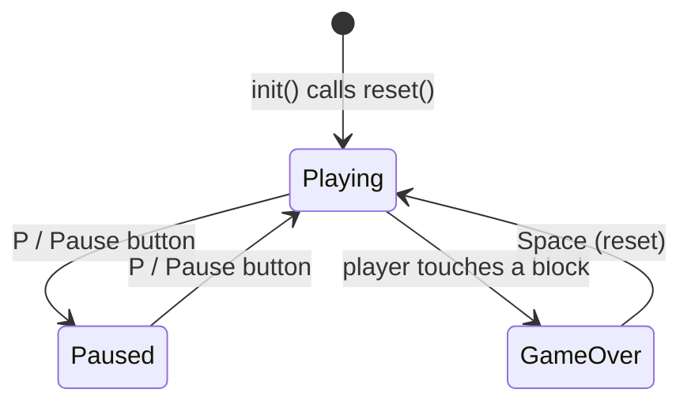
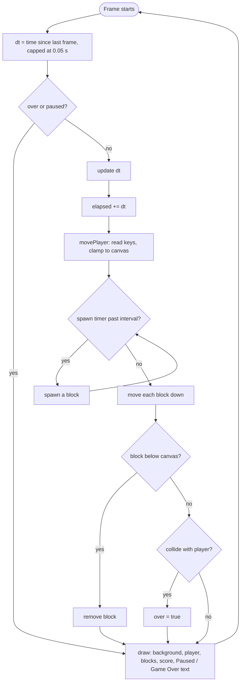

# Dodge

A small browser game. Move the blue square and dodge the falling red blocks for as long as you can. Your score is the number of whole seconds you survive.

Vanilla HTML, CSS and JS. No frameworks, no build step, no dependencies.

## Run it

```
python3 -m http.server 8000
```

Then open http://localhost:8000/index.html.

## Controls

| Key | Action |
| --- | --- |
| Arrow keys or WASD | Move |
| P (or the Pause button) | Pause / resume |
| Space | Restart after game over |

## How the game works

```
┌──────────────────────── Canvas 600 x 400 ────────────────────────┐
│ Score: 12                                                        │
│          ▇          ▇▇               ▇                           │
│          ▇   ▇      ▇▇     ▇        ▇        ▇   ◄ red blocks   │
│              ▇              ▇                  ▇     spawn above  │
│                    ▇                 ▇               the top and  │
│     ▇                                                 fall down   │
│                                                                  │
│                         ■  ◄ you (blue), can move anywhere       │
└──────────────────────────────────────────────────────────────────┘
```

### Game states



### Each frame

`init(canvas)` starts a `requestAnimationFrame` loop. Every frame does this:



### Difficulty ramp

The longer you survive (`elapsed` seconds), the harder it gets:

| What | Formula |
| --- | --- |
| Time between spawns | `max(0.25, 0.8 - elapsed * 0.02)` seconds |
| Block fall speed | `120 + elapsed * 12 + random(0..60)` px/s |
| Block size | random 20 to 50 px |

Spawns reach their fastest rate (one every 0.25 s) after about 27 seconds.

## Code layout

| File | Role |
| --- | --- |
| `index.html` | Canvas, Pause button, loads `game.js`, calls `init(...)` |
| `style.css` | Page and button styling |
| `game.js` | All game logic, split into small functions |

Functions in `game.js`:

| Function | Job |
| --- | --- |
| `init(canvas)` | Sets up key listeners and starts the loop |
| `reset()` | Fresh player, no blocks, score 0 |
| `update(dt)` | Advances time, player, spawning and blocks |
| `movePlayer(dt)` | Applies key input, keeps the player on screen |
| `spawn()` | Adds one block above the top edge |
| `collide(a, b)` | Box overlap test |
| `draw(ctx, state)` | Renders everything, including score and overlays |
| `togglePause()` | Flips pause (ignored after game over) |

The state passed to `draw` is `{ player: {x, y, size}, blocks: [{x, y, size}], elapsed, over }`, plus a `paused` flag.
